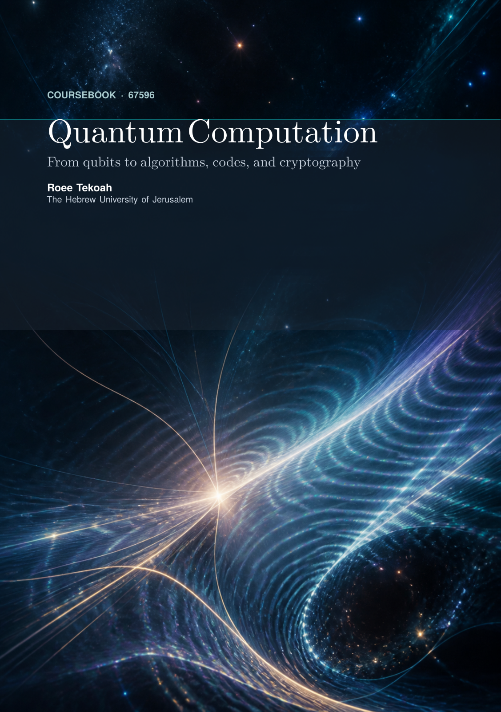
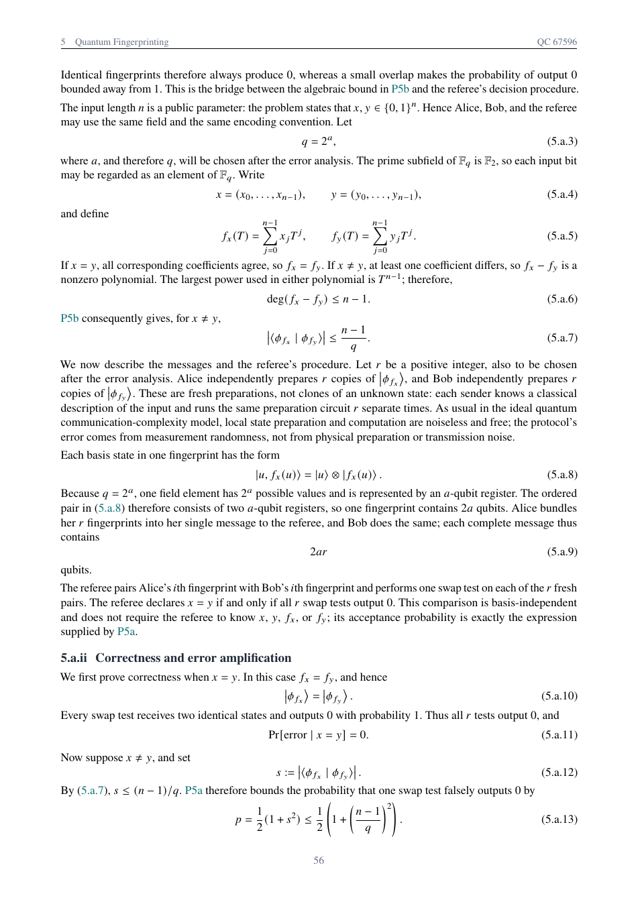
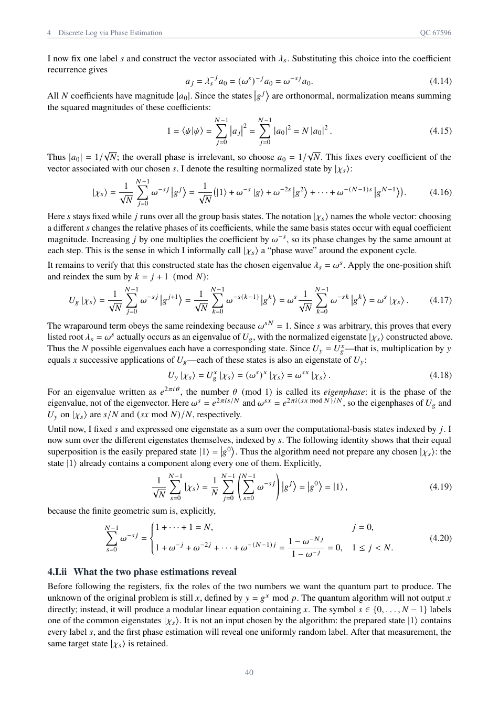

# Advanced Quantum Computation

<picture>
<source media="(prefers-color-scheme: dark)" srcset="assets/quantum-strip-dark.svg">

</picture>

Proofs and circuit constructions for quantum algorithms, quantum codes, and circuit complexity, alongside a review of quantum mean estimation.

<strong><a href="https://github.com/roeetekoah">Roee Tekoah</a></strong> &nbsp;·&nbsp; 

## Read the work

<table width="100%">
<tr>
<th width="33%">Advanced Quantum Computation</th>
<th width="33%">Appendices</th>
<th width="33%">Mean Estimation Review</th>
</tr>
<tr>
<td valign="top"><strong><a href="pdfs/quantum-computation-project.pdf">Read&nbsp;PDF</a></strong> · 63 pages Algorithms, codes, and circuit complexity.</td>
<td valign="top"><strong><a href="pdfs/project-appendices.pdf">Read&nbsp;PDF</a></strong> · 26 pages Supporting derivations and circuit primers.</td>
<td valign="top"><strong><a href="pdfs/quantum-mean-estimation-review.pdf">Read&nbsp;PDF</a></strong> · 5 pages Coherent access and spectral estimation.</td>
</tr>
</table>

<table width="100%">
<tr>
<td width="33%" align="center" valign="top"> <strong>Coursebook</strong> · Pending release</td>
<td width="33%" align="center" valign="top"> <strong>Quantum fingerprinting</strong> · Q5(a), p. 59</td>
<td width="33%" align="center" valign="top"> <strong>Discrete logarithms</strong> · Q4(I), p. 43</td>
</tr>
</table>

## Algorithms, Codes and Circuit Complexity

### Topic index

| Topic | Questions and clauses | PDF pages |
| --- | --- | --- |
| **Measurement & coherent control** Unread measurement, reversible control, and finite-gate compilation. | Q1: [(a)](pdfs/quantum-computation-project.pdf#page=4), [(b)](pdfs/quantum-computation-project.pdf#page=8) | [4–13](pdfs/quantum-computation-project.pdf#page=4) |
| **Quantum codes & local information** CSS maximal mixing and stabilizer-code local indistinguishability. | [P2a](pdfs/quantum-computation-project.pdf#page=14), [P2b](pdfs/quantum-computation-project.pdf#page=17); Q2: [(a)](pdfs/quantum-computation-project.pdf#page=19), [(b)](pdfs/quantum-computation-project.pdf#page=23) | [14–26](pdfs/quantum-computation-project.pdf#page=14) |
| **Circuit complexity & preparation** Encoding and preparation lower bounds, GHZ/W, and adaptive circuits. | Q3: [(A)](pdfs/quantum-computation-project.pdf#page=27), [(B)](pdfs/quantum-computation-project.pdf#page=29), [(C)](pdfs/quantum-computation-project.pdf#page=30), [(D)](pdfs/quantum-computation-project.pdf#page=34), [(E)](pdfs/quantum-computation-project.pdf#page=37) | [27–40](pdfs/quantum-computation-project.pdf#page=27) |
| **Discrete logarithms** Common eigenstates, finite phase readouts, and verified recovery. | Q4: [(I)](pdfs/quantum-computation-project.pdf#page=41), [(II)](pdfs/quantum-computation-project.pdf#page=44), [(III)](pdfs/quantum-computation-project.pdf#page=52) | [41–54](pdfs/quantum-computation-project.pdf#page=41) |
| **Quantum fingerprinting** Polynomial encodings, swap-test amplification, and circuit costs. | [P5a](pdfs/quantum-computation-project.pdf#page=55), [P5b](pdfs/quantum-computation-project.pdf#page=57); Q5: [(a)](pdfs/quantum-computation-project.pdf#page=58), [(b)](pdfs/quantum-computation-project.pdf#page=61) | [55–63](pdfs/quantum-computation-project.pdf#page=55) |

Supporting material: [Appendix A — Q1](pdfs/project-appendices.pdf#page=3), [Appendix B — Q2](pdfs/project-appendices.pdf#page=10), [Appendix C — Q4](pdfs/project-appendices.pdf#page=19), and [Appendix D — Q5](pdfs/project-appendices.pdf#page=25).

For cross-document links, download the report and appendices together. Page numbers count **PDF pages, including the cover**. P2a, P2b, P5a and P5b are preliminary results.

## Academic context

Developed in Prof. Michael Ben-Or's advanced quantum computation course at the Hebrew University of Jerusalem (67596; official title: *Introduction to Quantum Computation*).

The paper review examines [Kothari and O'Donnell's quantum mean-estimation algorithm](https://arxiv.org/abs/2208.07544).

## Companion coursebook

**In progress · Pending release**

I am developing the surrounding material into a coursebook, from reversible computation and quantum algorithms to codes, quantum information, and cryptography. Only the cover is shown here; the draft is not included.

## Copyright

Copyright (c) 2026 Roee Tekoah. **All rights reserved.** See [LICENSE](LICENSE). Contact: [roeetekoah@gmail.com](mailto:roeetekoah@gmail.com).
